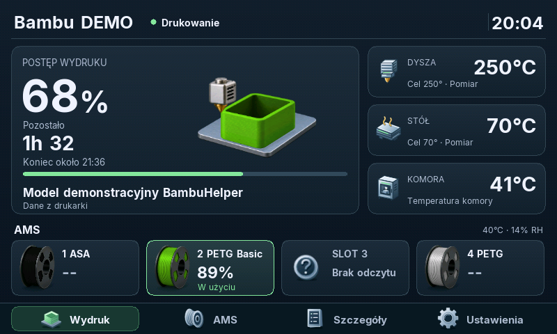
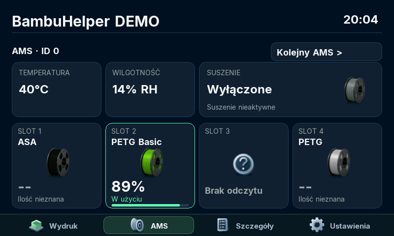
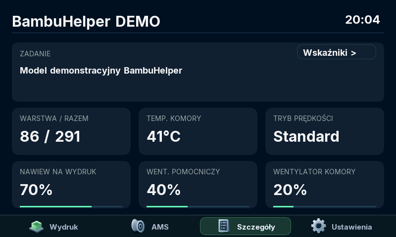
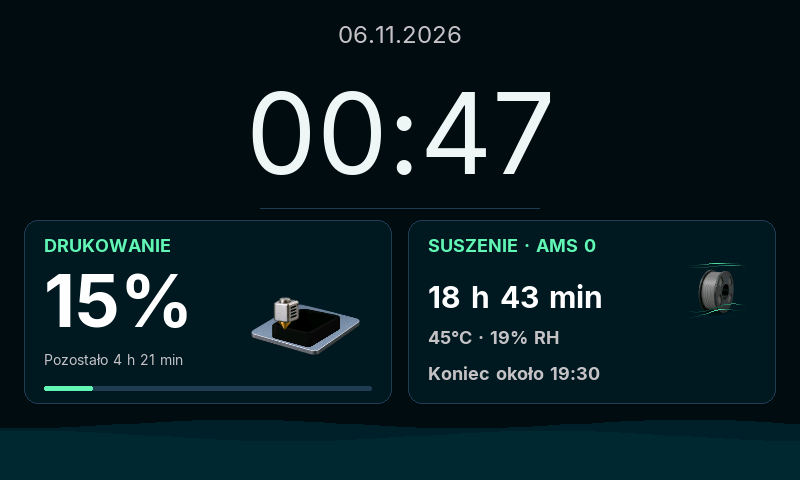

# BambuHelper — Waveshare 4.3B

[English](README.md) | [Polski](README.pl.md) | **Deutsch**

**Ein 4,3″-Touchpanel, das neben deinem Bambu-Lab-Drucker steht und alles Wichtige zeigt — Druckfortschritt, AMS und Temperaturen — ohne zum Handy zu greifen.**

  <a href="https://honzo90.github.io/BambuHelper/?lang=de"><b>▶ Im Browser installieren</b></a>
  &nbsp;·&nbsp;
  <a href="https://github.com/honzo90/BambuHelper/releases/tag/v4.1.0">v4.1.0 herunterladen</a>
  &nbsp;·&nbsp;
  <a href="#neu-in-v410">Neuigkeiten</a>

## Was es kann

- **Druckfortschritt auf einen Blick** — Prozent, Restzeit und Endzeit, Modellname.
- **Vollständige AMS-Ansicht** — Farbe und Material in jedem Slot, aktive Spule, Feuchtigkeit und Trocknung.
- **Temperaturen und Lüfter** — Düse, Bett und Kammer mit Zielwerten.
- **Uhr und Wetter** — ohne Berührung wird das Panel zur Uhr mit Druck- und Trocknungsfortschritt; die Ziffern blättern wie ein Kalender.
- **Rücksichtsvoll bei Nacht** — dunkelt in der Dämmerung ab, schaltet nachts aus oder zeigt eine gedimmte Uhr. Eine Berührung bringt sofort volle Helligkeit.
- **Alles am Panel oder im Browser einstellbar** — auf Deutsch, Englisch oder Polnisch.
- **Updates mit einem Klick** — das WebUI prüft und installiert neue Versionen direkt von GitHub.

| AMS | Druckdetails |
|---|---|
|  |  |

Bildschirmschoner-Uhr — Druck und Trocknung gleichzeitig

Dashboard, AMS und Details: aus dem Firmware-Code mit Demodaten gerendert. Bildschirmschoner: Aufnahme eines echten Panels.

## Was du brauchst

- Ein **Waveshare ESP32-S3-Touch-LCD-4.3B** (Version **B**, 800×480) — fertige Platine, kein Löten.
- Einen Bambu-Lab-Drucker im selben WLAN (LAN-Modus) oder ein Bambu-Cloud-Konto.
- Für die Erstinstallation: einen Computer mit **Chrome** oder **Edge** und ein USB-Datenkabel.

## Installation in drei Schritten

1. Öffne den **[Installer](https://honzo90.github.io/BambuHelper/?lang=de)**, verbinde das Panel per USB und klicke auf **Verbinden und installieren**.
2. Das Panel zeigt einen QR-Code für sein Einrichtungsnetz — scanne ihn mit dem Handy, öffne die angezeigte Seite und wähle dein WLAN.
3. Öffne das WebUI des Panels (Adresse und QR-Code am Panel: **Einstellungen → Sprache und WebUI**) und füge den Drucker hinzu: IP-Adresse, Seriennummer und Zugangscode vom Druckerdisplay oder Bambu-Cloud-Anmeldung.

Fertig. Spätere Versionen installierst du im WebUI des Panels: **Stable → Nach Updates suchen**.

> Die Erstinstallation löscht das Panel. Läuft es bereits, aktualisiere über das WebUI — die Einstellungen bleiben erhalten.

## Neu in v4.1.0

- Nachtzeiten minutengenau — am Panel oder im Browser.
- Abdunkeln in der Dämmerung mit Bildschirmschoner, auch während des Drucks; sanftes Abblenden und sofort volle Helligkeit bei Berührung.
- Eine Uhr, deren Ziffern wie Kalenderblätter umblättern.
- Neue Einstellungen am Panel: Nacht, Darstellung, „Sprache und WebUI“ mit Version, IP-Adresse und WLAN-Signal.
- WLAN-Diagnose: Wenn das Panel dein Netz nicht erreicht, sagt es dir warum.
- Schnellerer Bildschirm (Animationen etwa 3× flüssiger), 182 KB kleinere Firmware und deutlich mehr freier Speicher.

[Vollständige Versionshinweise](https://github.com/honzo90/BambuHelper/releases/tag/v4.1.0) · [Alle Releases](https://github.com/honzo90/BambuHelper/releases)

## Bekannte Probleme

- Gelegentliche Bildstörungen bei langen Drucken — eine Korrektur ist im Test.
- [Schwarzer Bildschirm, der nicht per Berührung aufwacht (#1)](https://github.com/honzo90/BambuHelper/issues/1) — selten beobachtet.

Etwas funktioniert nicht? [Problem melden](https://github.com/honzo90/BambuHelper/issues).

<b>Für Entwickler</b>

- Build: Arduino CLI mit **Arduino ESP32 3.3.11** / **ESP-IDF 5.5.5** und eigenem SDK mit XIP aus dem PSRAM (cache64_xip), RGB-Takt 12 MHz — Details in [WAVESHARE.md](WAVESHARE.md) und in der `BUILD-INFO.json` jedes Releases.
- Panel-Code: [Bildschirme](src/display_ws43b.cpp), [Displaytreiber](src/lgfx_panel_ws43b.cpp), [Touch](src/button_touch_ws43b.cpp), [MQTT](src/bambu_mqtt.cpp).
- Host-Tests: [bringup/waveshare43b/integration/tests](bringup/waveshare43b/integration/tests).
- Branch-Regeln und Upstream-Abgleich: [docs/UPSTREAM.md](docs/UPSTREAM.md).

## Basisprojekt und Lizenz

Ein Fork von [BambuHelper von Keralots und Mitwirkenden](https://github.com/Keralots/BambuHelper), angepasst an das Waveshare-4.3B-Panel. Die Originaldokumentation (andere Platinen, Bambu Cloud, HMS-Fehlercodes) steht in [docs/UPSTREAM_README.md](docs/UPSTREAM_README.md) (Englisch).

MIT-Lizenz · [Komponenten von Drittanbietern](THIRD_PARTY_NOTICES.md)
