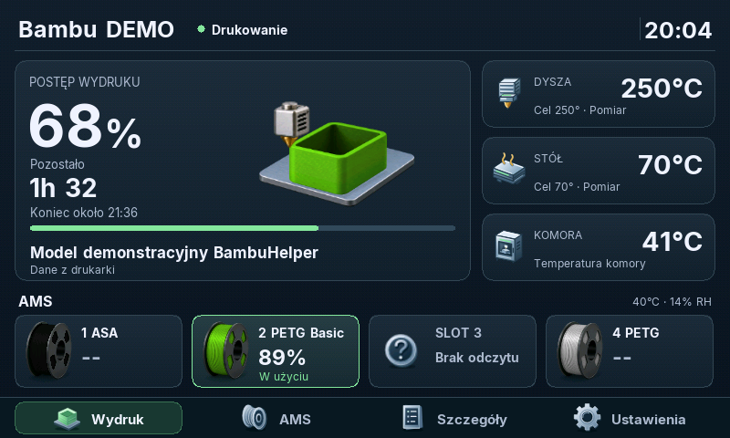
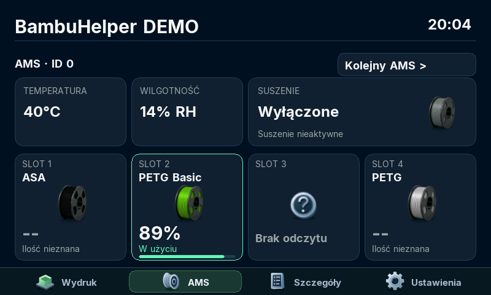
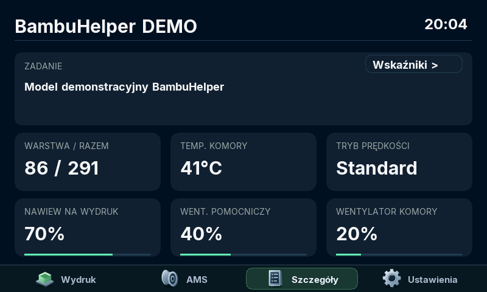
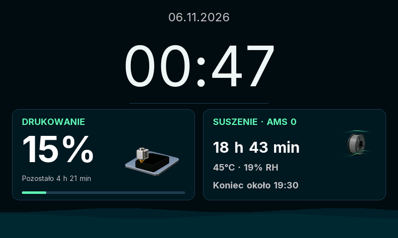

# BambuHelper — Waveshare 4.3B

**English** | [Polski](README.pl.md) | [Deutsch](README.de.md)

**A 4.3″ touch panel that sits next to your Bambu Lab printer and shows everything that matters — print progress, AMS and temperatures — without reaching for your phone.**

  <a href="https://honzo90.github.io/BambuHelper/?lang=en"><b>▶ Install from your browser</b></a>
  &nbsp;·&nbsp;
  <a href="https://github.com/honzo90/BambuHelper/releases/tag/v4.1.0">Download v4.1.0</a>
  &nbsp;·&nbsp;
  <a href="#whats-new-in-v410">What's new</a>

## What it does

- **Print progress at a glance** — percent, time left and finish time, model name.
- **Full AMS view** — colour and material in every slot, the active spool, humidity and drying.
- **Temperatures and fans** — nozzle, bed and chamber with their targets.
- **Clock and weather** — when you are not touching it, the panel becomes a clock with print and drying progress; the digits turn like calendar pages.
- **Kind at night** — dims at dusk, switches off or shows a dimmed clock at night. A touch brings full brightness back instantly.
- **Set everything on the panel or in the browser** — in English, Polish or German.
- **One-click updates** — the WebUI checks and installs new versions straight from GitHub.

| AMS | Print details |
|---|---|
|  |  |

Screensaver clock — printing and drying at once

Dashboard, AMS and details: rendered from the firmware code with demo data. Screensaver: captured from a real panel.

## What you need

- A **Waveshare ESP32-S3-Touch-LCD-4.3B** (the **B** version, 800×480) — a ready-made board, no soldering.
- A Bambu Lab printer on the same Wi-Fi (LAN mode) or a Bambu Cloud account.
- For the first install: a computer with **Chrome** or **Edge** and a USB data cable.

## Install in three steps

1. Open the **[installer](https://honzo90.github.io/BambuHelper/?lang=en)**, connect the panel over USB and click **Connect and install**.
2. The panel shows a QR code for its setup network — scan it with your phone, open the page shown on screen and pick your home Wi-Fi.
3. Open the panel WebUI (address and QR code on the panel: **Settings → Language and WebUI**) and add your printer: IP address, serial number and access code from the printer screen, or a Bambu Cloud login.

Done. Later versions install from the panel WebUI: **Stable → Check for updates**.

> The first install erases the panel. If it already runs, update through the WebUI — your settings stay.

## What's new in v4.1.0

- Night hours to the minute — on the panel or in the browser.
- Dimming at dusk with the screensaver, also while printing; smooth fade and instant full brightness on touch.
- A clock that turns its digits like calendar pages.
- New on-panel settings: Night, Appearance, "Language and WebUI" with version, IP address and Wi-Fi signal.
- Wi-Fi diagnosis: if the panel cannot join your network, it tells you why.
- Faster screen (animations about 3× smoother), 182 KB smaller firmware and much more free memory.

[Full release notes](https://github.com/honzo90/BambuHelper/releases/tag/v4.1.0) · [All releases](https://github.com/honzo90/BambuHelper/releases)

## Known issues

- Occasional picture glitches during long prints — a fix is in testing in [v4.1.1-beta.1](https://github.com/honzo90/BambuHelper/releases/tag/v4.1.1-beta.1) (panel WebUI: **Beta → Check for updates**).
- [Black screen that does not wake on touch (#1)](https://github.com/honzo90/BambuHelper/issues/1) — seen rarely.

Something not working? [Open an issue](https://github.com/honzo90/BambuHelper/issues).

<b>For developers</b>

- Build: Arduino CLI with **Arduino ESP32 3.3.11** / **ESP-IDF 5.5.5** and a custom SDK with XIP from PSRAM (cache64_xip), 12 MHz RGB clock — see [WAVESHARE.md](WAVESHARE.md) and the `BUILD-INFO.json` of each release.
- Panel code: [screens](src/display_ws43b.cpp), [display driver](src/lgfx_panel_ws43b.cpp), [touch](src/button_touch_ws43b.cpp), [MQTT](src/bambu_mqtt.cpp).
- Host tests: [bringup/waveshare43b/integration/tests](bringup/waveshare43b/integration/tests).
- Branch policy and upstream sync: [docs/UPSTREAM.md](docs/UPSTREAM.md).

## Based on BambuHelper · License

A fork of [BambuHelper by Keralots and contributors](https://github.com/Keralots/BambuHelper), tailored to the Waveshare 4.3B panel. The original documentation (other boards, Bambu Cloud, HMS error codes) lives in [docs/UPSTREAM_README.md](docs/UPSTREAM_README.md).

MIT license · [Third-party notices](THIRD_PARTY_NOTICES.md)
