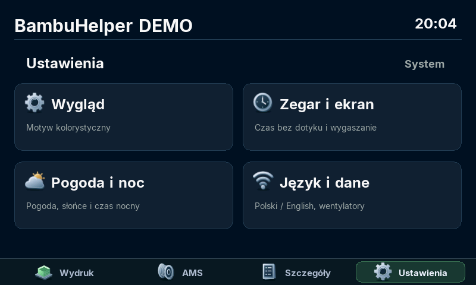
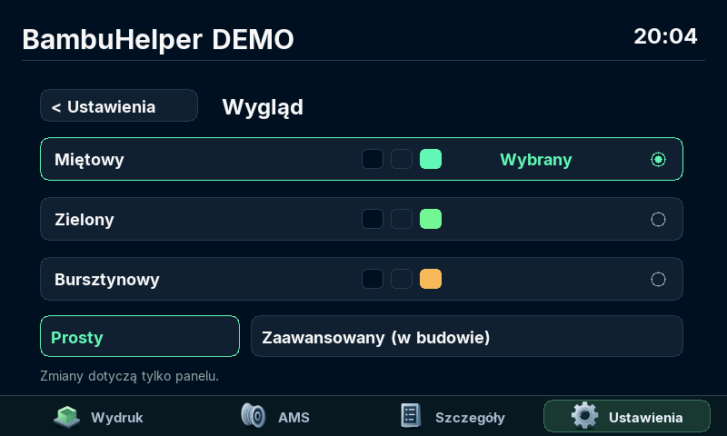
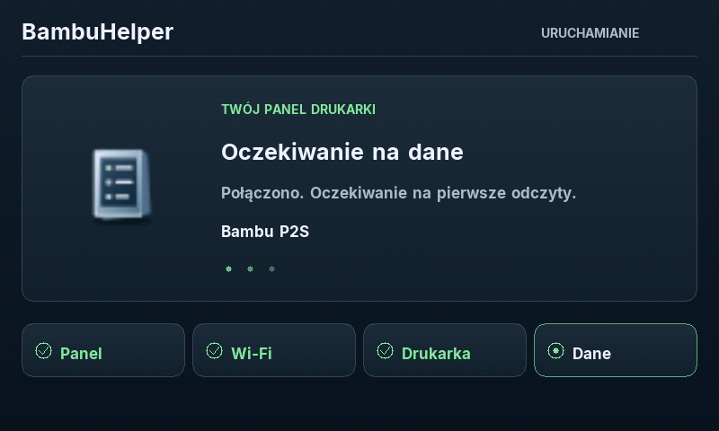

# BambuHelper — Waveshare 4.3B

[English](README.md) | **Polski** | [Deutsch](README.de.md)

Monitor drukarek Bambu Lab dla **Waveshare ESP32-S3-Touch-LCD-4.3B**, z dotykowym ekranem RGB **800×480**. Pokazuje dane drukarki i AMS, postęp wydruku, zegar i opcjonalną pogodę. Interfejs panelu oraz konfiguracja przez przeglądarkę są dostępne po polsku, angielsku i niemiecku.

To fork projektu [BambuHelper autorstwa Keralots i współtwórców](https://github.com/Keralots/BambuHelper). Gałąź `waveshare-43b` powstała na bazie oryginalnej wersji **v3.9.0** (`23347fbb`); `main` zachowuje historię projektu źródłowego.

**Aktualna wersja stabilna: [v4.0.0](https://github.com/honzo90/BambuHelper/releases/tag/v4.0.0).** Zawiera poprawkę artefaktów ekranu z Bety 5, występujących podczas zapisywania ustawień, m.in. pogody i trybu nocnego. Wydanie korzysta z przebudowanego SDK z XIP z PSRAM oraz żądanego zegara RGB **12 MHz**. Zachowuje funkcje Bety 5 i interfejs **PL / EN / DE**. Ekran startowy nadal pokazuje oznaczenie v0.9; numer firmware w informacjach o urządzeniu to **v4.0.0**.

**Potwierdzenie z urządzenia:** właściciel projektu potwierdził działanie Bety 5 i stabilny obraz na fizycznym ekranie. v4.0.0 to ponowna kompilacja tego samego kodu ze zmienionym wyłącznie numerem firmware; obrazu z nowym numerem nie testowano osobno na sprzęcie. Długotrwała praca i odzyskiwanie po zakłóceniach wymagają dalszego sprawdzenia. Wcześniejszy [problem ciemnego ekranu i braku wybudzania dotykiem](https://github.com/honzo90/BambuHelper/issues/1) pozostaje otwarty do obserwacji.

## Wersja testowa: v4.1.0-beta.19

> Nowy firmware jest **w testach beta**. Wersją stabilną pozostaje [v4.0.0](https://github.com/honzo90/BambuHelper/releases/tag/v4.0.0). Instaluj betę tylko, jeśli chcesz testować nowości; pełny opis: [v4.1.0-beta.19](https://github.com/honzo90/BambuHelper/releases/tag/v4.1.0-beta.19).

**Co jest nowe lub inaczej**
- **Godziny nocy z minutami** — na panelu (siatka godzin, potem minuty co 5 min) albo dowolna minuta w WebUI.
- **Przyciemnianie o zmroku zamiast wcześniejszej nocy** — od zachodu słońca do początku nocy panel po nocnym czasie bez dotyku przygasa do 50% i przechodzi do wygaszacza, także podczas druku. Noc (wyłączony ekran albo zegar 30%) działa tylko w ustawionych godzinach. *Jeśli korzystałeś z „nocy od zachodu słońca”, sprawdź po aktualizacji godziny nocy.*
- **Płynne przygaszanie**, natychmiastowa pełna jasność po dotyku.
- **Zegar w wygaszaczu** zmienia cyfry jak kartka kalendarza; ekran startowy pokazuje prawdziwą wersję firmware.
- **Menu ustawień na panelu**: ekran Noc, Wygląd (motyw, tryb ekranu, wentylatory), „Język i WebUI” z wersją, adresem IP i sygnałem Wi-Fi, przełącznik Pong.
- **WebUI**: nowy układ sekcji „Ekran”; ukryte ustawienia, których ekran 4.3B nie używa.
- **Diagnoza Wi-Fi** (z oryginalnego projektu): gdy panel nie połączy się z zapisaną siecią, ekran i strona konfiguracji wyjaśniają dlaczego (brak sieci, wielkość liter w nazwie, słaby sygnał, błędne hasło, sieć firmowa, brak adresu IP).

**Co jest poprawione**
- Szybsze odświeżanie ekranu (klatka wygaszacza ok. 34–66 ms zamiast ok. 168 ms, animacja zegara ok. 14 klatek/s zamiast ok. 4).
- Firmware mniejszy o 182 KB (skompresowane strony WebUI).
- Znacznie więcej wolnej pamięci wewnętrznej: bufory szyfrowanego połączenia z drukarką w PSRAM — po aktualizacji zostaje ok. 46–62 KB zapasu zamiast ok. 3 KB, nawet gdy przeglądarka przeładowuje WebUI.
- Zegar w wygaszaczu nie pokazuje już na chwilę „--:--”.

**Instalacja:** WebUI → **Beta → Sprawdź aktualizacje**. **Powrót do stabilnej:** prześlij plik OTA z [v4.0.0](https://github.com/honzo90/BambuHelper/releases/tag/v4.0.0) w aktualizacji ręcznej. Otwarte sprawy: sporadyczne artefakty obrazu podczas długiego druku (w trakcie analizy) i wybudzanie dotykiem ([#1](https://github.com/honzo90/BambuHelper/issues/1)).

## Instalacja i aktualizacje

### Pierwsza instalacja przez USB

Instalator USB nadal udostępnia **Betę 2**. Po pierwszej konfiguracji zaktualizuj panel do **v4.0.0** przez OTA w kanale **Stable**.

1. Otwórz **[instalator BambuHelper](https://honzo90.github.io/BambuHelper/)** w Chrome lub Edge na komputerze. Instalacja przez USB nie działa na iPhonie.
2. Podłącz panel kablem USB obsługującym transmisję danych. Instalator jest przeznaczony wyłącznie dla **Waveshare ESP32-S3-Touch-LCD-4.3B**.
3. Potwierdź model płytki i usunięcie ustawień. Wybierz **Przygotuj instalację**, a następnie **Połącz i zainstaluj**.
4. Po wgraniu skonfiguruj Wi-Fi przez sieć panelu; dane połączenia pojawią się na ekranie. W WebUI panelu wybierz **Stable → Sprawdź aktualizacje** i zainstaluj **v4.0.0**.

**Pierwsza instalacja kasuje pamięć flash, w tym ustawienia Wi-Fi, drukarki i poprzedni firmware.** Strona sprawdza obraz przed udostępnieniem instalacji. Samo wgranie przez przeglądarkę wymaga jeszcze testu na fizycznej płytce.

### Aktualizacja działającego panelu przez OTA

- W WebUI wybierz **Stable → Sprawdź aktualizacje** i zainstaluj **v4.0.0**. W v3.9.1 i v4.0.0-alpha.1 użyj dotychczasowej funkcji sprawdzania aktualizacji; wersje bez wyboru kanału sprawdzają wydania stabilne. Kanał Beta również oferuje v4.0.0 jako wersję nowszą od Bety 5.
- **Ręczna aktualizacja:** pobierz [`BambuHelper-ws_lcd_43b-v4.0.0-ota.bin`](https://github.com/honzo90/BambuHelper/releases/download/v4.0.0/BambuHelper-ws_lcd_43b-v4.0.0-ota.bin) i prześlij go na stronie aktualizacji firmware w WebUI. To również opcja, gdy aktualizator online nie oferuje wydania.
- [Opis wydania i źródła v4.0.0](https://github.com/honzo90/BambuHelper/releases/tag/v4.0.0) · [Sumy kontrolne](https://github.com/honzo90/BambuHelper/releases/download/v4.0.0/SHA256SUMS) · [Wszystkie wydania](https://github.com/honzo90/BambuHelper/releases).

OTA wymaga istniejącego układu partycji WS43B z **dwoma slotami po 3 MiB**. Plik OTA zawiera samą aplikację i nie służy do pierwszej instalacji. Oryginalny instalator projektu Keralots nie obsługuje tego portu 4.3B.

## Funkcje forka

| Obszar | Co zawiera wersja WS43B |
|---|---|
| **Obsługa płytki** | Wyświetlacz RGB ST7262 800×480, dotyk pojemnościowy GT911 przez I2C oraz obsługa podświetlenia. |
| **Interfejs dotykowy** | Widoki pulpitu, AMS, szczegółów druku, wskaźników, zegara i ustawień z nawigacją dla panelu 4,3 cala. |
| **Telemetria drukarki** | MQTT/TLS przez LAN Direct lub Bambu Cloud; postęp, warstwy, pozostały czas, temperatury i odczyty wentylatorów, gdy drukarka je udostępnia. |
| **Telemetria AMS** | Materiał, kolor, pozostały filament, temperatura, wilgotność i stan suszenia w zakresie raportowanym przez drukarkę lub AMS. |
| **Aktualność danych** | Ocena poprawności i wieku poszczególnych odczytów, zachowywanie pól pominiętych w przyrostowych raportach MQTT oraz odróżnianie zera od braku danych. |
| **Tryby wyświetlania** | Tryb prosty i rozwijany tryb zaawansowany; widoki druku, suszenia i chłodzenia, zegar oraz wygaszacze, w tym Pong i zegar wodny. |
| **Polski / English / Deutsch** | Zapisywany wybór języka wspólny dla panelu i portalu konfiguracji. Niemiecki jest dostępny od `v4.0.0-beta.3`. |
| **Opcjonalna pogoda** | Dane Open-Meteo, wschód i zachód słońca oraz harmonogram nocny. Pogoda i wyszukiwanie lokalizacji wymagają Internetu. |
| **Konfiguracja i diagnostyka** | Ustawienia Wi-Fi, drukarki i ekranu, funkcje sterowania i OTA oraz `/monitor/status` i narzędzia przechwytywania obrazu na potrzeby rozwoju. |
| **Budowanie i testy** | Osobny proces Arduino CLI z ustaloną wersją SDK (cache64_xip w v4.0.0), testy na komputerze, syntetyczne dane MQTT oraz generatory grafik i czcionek. |

MQTT, integracja z chmurą, portal WWW i obsługa pozostałych płytek pochodzą z oryginalnego projektu. Fork rozszerza je dla Waveshare 4.3B. Profil `BAMBU_MONITOR_ONLY=0` zawiera również kod sterowania oświetleniem komory i inteligentnym gniazdkiem. Zakres działania innych płytek, modeli drukarek i konfiguracji wielu drukarek nie został w całości zweryfikowany w tym forku.

## Przykładowe układy ekranów

To **podglądy 800×480 generowane na komputerze** przy użyciu funkcji wyświetlania, czcionek i grafik projektu oraz syntetycznych danych. Pokazują polski interfejs. Nagłówek demonstracyjny i sposób rysowania mogą różnić się od urządzenia. Podglądy nie są zdjęciami ani zrzutami z panelu i nie potwierdzają stabilności ekranu, dotyku ani wybudzania.

| Pulpit druku | AMS |
|---|---|
|  |  |

| Szczegóły druku | Ustawienia |
|---|---|
|  |  |

| Wygląd | Uruchamianie |
|---|---|
|  |  |

[Pochodzenie podglądów i sumy kontrolne źródeł](img/waveshare-43b/provenance.json).

## Budowanie i weryfikacja

**Wydanie v4.0.0** korzysta z **Arduino ESP32 3.3.11**, **ESP-IDF 5.5.5**, przebudowanego SDK **cache64_xip** i żądanego zegara RGB **12 MHz**. Dokładne źródła wskazuje [tag v4.0.0](https://github.com/honzo90/BambuHelper/tree/v4.0.0), a pochodzenie SDK, konfigurację i wyniki weryfikacji opisuje [BUILD-INFO.json](https://github.com/honzo90/BambuHelper/releases/download/v4.0.0/BUILD-INFO.json). Odtworzenie wymaga osobno przygotowanego SDK XIP, zgodnego manifestu i jego SHA-256 oraz ustawień `WS43B_SDK_PROFILE=cache64_xip` i `WS43B_RGB_PCLK_HZ=12000000`. Domyślny build cache64 nie odtwarza tego wydania.

Do prac rozwojowych służą **[instrukcje budowania i testów Waveshare](WAVESHARE.md)** (po angielsku), profil [`boards/ws_lcd_43b.ini`](boards/ws_lcd_43b.ini) oraz [`bringup/waveshare43b/integration/build.py`](bringup/waveshare43b/integration/build.py). To osobny proces Arduino CLI, nie środowisko PlatformIO.

Kompilacja i kontrole obrazu v4.0.0 przeszły pomyślnie, podobnie jak **48 przypadków wyboru aktualizacji** w ośmiu kombinacjach źródeł i języka. Zakres fizycznego potwierdzenia opisano powyżej; wyniki kompilacji i testów na komputerze nie zastępują sprawdzenia sprzętu.

## Mapa źródeł

- **Ekran i dotyk:** [integracja wyświetlacza](src/lgfx_panel_ws43b.cpp), [obsługa dotyku](src/button_touch_ws43b.cpp), [interfejs panelu](src/display_ws43b.cpp).
- **Telemetria i MQTT:** [stan danych](include/bambu_monitor.h), [parser raportów](include/bambu_monitor_parser.h), [połączenie MQTT](src/bambu_mqtt.cpp).
- **Zegar, pogoda, język:** [ustawienia zegara](src/ws43b_clock_settings.cpp), [pogoda](src/ws43b_weather.cpp), [wybór języka](src/ws43b_language.cpp).
- **Narzędzia:** [testy na komputerze](bringup/waveshare43b/integration/tests), [przygotowanie kompilacji](prepare_build.py), [informacje o komponentach zewnętrznych](THIRD_PARTY_NOTICES.md).

## Dokumentacja oryginalnego projektu

Poniższe odnośniki prowadzą do zachowanej **angielskiej dokumentacji upstream**. Obejmuje ona także inne płytki; jej instrukcji połączeń GPIO, PlatformIO i instalatora nie należy stosować bezpośrednio do WS43B. Dla 4.3B korzystaj z instrukcji powyżej i pliku `WAVESHARE.md`.

- [Obsługiwane płytki](README.md#supported-boards)
- [Łączenie z Bambu Cloud](README.md#connecting-to-bambu-cloud)
- [Bezpieczeństwo połączenia z chmurą](README.md#cloud-mode-security-notice)
- [Pomiar zużycia energii](README.md#power-monitoring)
- [Błędy drukarki i kody HMS](README.md#printer-errors-hms)
- [Własne czcionki](README.md#custom-smooth-fonts)

Polski dokument opisuje fork WS43B. Szczegółowa dokumentacja pozostałych płytek pozostaje w oryginalnej wersji językowej.

## Licencja i autorstwo

MIT. Projekt bazowy: [BambuHelper — Keralots i współtwórcy](https://github.com/Keralots/BambuHelper). Licencje komponentów zewnętrznych opisuje [THIRD_PARTY_NOTICES.md](THIRD_PARTY_NOTICES.md).
