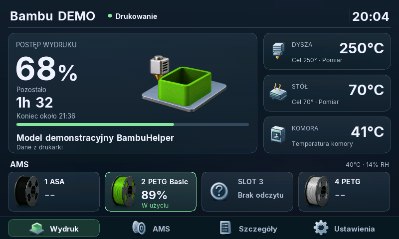
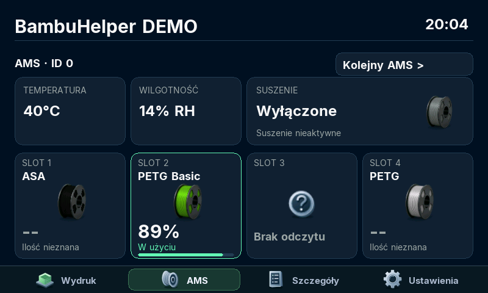
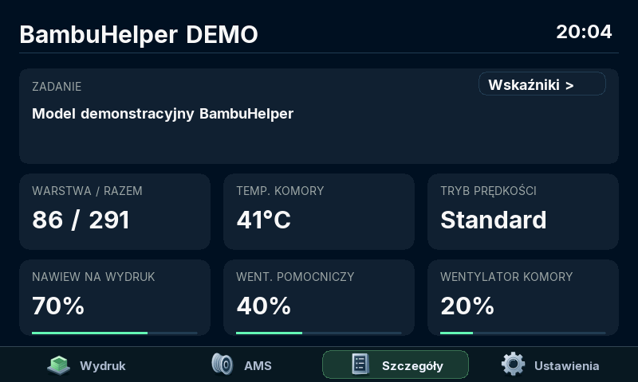
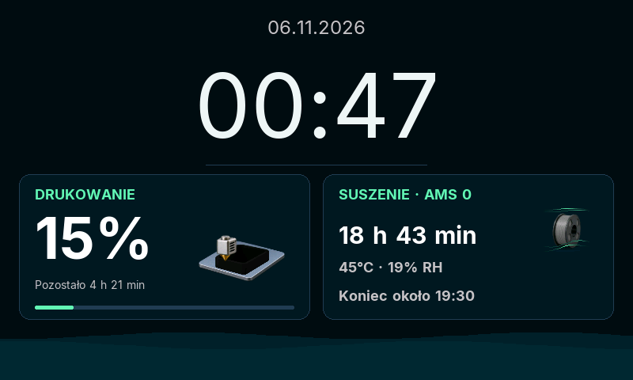

# BambuHelper — Waveshare 4.3B

[English](README.md) | **Polski** | [Deutsch](README.de.md)

**Dotykowy panel 4,3″, który stoi obok drukarki Bambu Lab i pokazuje wszystko, co ważne — postęp druku, AMS i temperatury — bez sięgania po telefon.**

  <a href="https://honzo90.github.io/BambuHelper/?lang=pl"><b>▶ Zainstaluj przez przeglądarkę</b></a>
  &nbsp;·&nbsp;
  <a href="https://github.com/honzo90/BambuHelper/releases/tag/v4.1.0">Pobierz v4.1.0</a>
  &nbsp;·&nbsp;
  <a href="#co-nowego-w-v410">Co nowego</a>

## Co potrafi

- **Postęp druku na pierwszy rzut oka** — procent, pozostały czas i godzina zakończenia, nazwa modelu.
- **Pełny podgląd AMS** — kolor i rodzaj filamentu w każdym slocie, aktywna szpula, wilgotność i suszenie.
- **Temperatury i wentylatory** — dysza, stół i komora z wartościami docelowymi.
- **Zegar i pogoda** — gdy nie dotykasz panelu, zamienia się w zegar z postępem druku i suszenia; cyfry zmieniają się jak kartki kalendarza.
- **Dba o noc** — o zmroku przygasa, w nocy gaśnie albo pokazuje przyciemniony zegar. Dotyk od razu przywraca pełną jasność.
- **Wszystko ustawisz na panelu albo w przeglądarce** — po polsku, angielsku lub niemiecku.
- **Aktualizacje jednym kliknięciem** — WebUI sprawdza i instaluje nowe wersje prosto z GitHuba.

| AMS | Szczegóły druku |
|---|---|
|  |  |

Wygaszacz z zegarem — druk i suszenie naraz

Pulpit, AMS i szczegóły: zrzuty z kodu firmware na danych demonstracyjnych. Wygaszacz: zrzut z prawdziwego panelu.

## Czego potrzebujesz

- Panel **Waveshare ESP32-S3-Touch-LCD-4.3B** (wersja **B**, 800×480) — gotowa płytka, bez lutowania.
- Drukarkę Bambu Lab w tej samej sieci Wi-Fi (tryb LAN) albo konto Bambu Cloud.
- Do pierwszej instalacji: komputer z **Chrome** lub **Edge** i kabel USB do transmisji danych.

## Instalacja w trzech krokach

1. Otwórz **[instalator](https://honzo90.github.io/BambuHelper/?lang=pl)**, podłącz panel przez USB i kliknij **Połącz i zainstaluj**.
2. Panel pokaże kod QR swojej sieci konfiguracyjnej — zeskanuj go telefonem, otwórz stronę z ekranu i wybierz domową sieć Wi-Fi.
3. Otwórz WebUI panelu (adres i kod QR znajdziesz na panelu: **Ustawienia → Język i WebUI**) i dodaj drukarkę: adres IP, numer seryjny i kod dostępu z ekranu drukarki albo logowanie do Bambu Cloud.

Gotowe. Kolejne wersje instalujesz w WebUI panelu: **Stable → Sprawdź aktualizacje**.

> Pierwsza instalacja kasuje pamięć panelu. Jeśli panel już działa, aktualizuj go przez WebUI — ustawienia zostaną.

## Co nowego w v4.1.0

- Godziny nocy ustawiane co do minuty — na panelu lub w przeglądarce.
- Przygaszanie o zmroku z wygaszaczem, także w trakcie druku; płynne ściemnianie i natychmiastowa pełna jasność po dotyku.
- Zegar zmieniający cyfry jak kartka kalendarza.
- Nowe menu ustawień na panelu: Noc, Wygląd, „Język i WebUI” z wersją, adresem IP i siłą sygnału Wi-Fi.
- Diagnoza Wi-Fi: gdy panel nie połączy się z siecią, wyjaśnia dlaczego.
- Szybszy ekran (animacje ok. 3× płynniejsze), firmware mniejszy o 182 KB i dużo więcej wolnej pamięci.

[Pełny opis wydania](https://github.com/honzo90/BambuHelper/releases/tag/v4.1.0) · [Wszystkie wydania](https://github.com/honzo90/BambuHelper/releases)

## Znane problemy

- Sporadyczne zakłócenia obrazu podczas długich wydruków — poprawka jest w testach w [v4.1.1-beta.1](https://github.com/honzo90/BambuHelper/releases/tag/v4.1.1-beta.1) (WebUI panelu: **Beta → Sprawdź aktualizacje**).
- [Czarny ekran i brak wybudzenia dotykiem (#1)](https://github.com/honzo90/BambuHelper/issues/1) — obserwowane rzadko.

Coś nie działa? [Zgłoś problem](https://github.com/honzo90/BambuHelper/issues).

<b>Dla programistów</b>

- Build: Arduino CLI z **Arduino ESP32 3.3.11** / **ESP-IDF 5.5.5** i własnym SDK z XIP z PSRAM (cache64_xip), zegar RGB 12 MHz — szczegóły w [WAVESHARE.md](WAVESHARE.md) i w `BUILD-INFO.json` każdego wydania.
- Kod panelu: [ekran](src/display_ws43b.cpp), [sterownik wyświetlacza](src/lgfx_panel_ws43b.cpp), [dotyk](src/button_touch_ws43b.cpp), [MQTT](src/bambu_mqtt.cpp).
- Testy na komputerze: [bringup/waveshare43b/integration/tests](bringup/waveshare43b/integration/tests).
- Zasady gałęzi i synchronizacja z oryginałem: [docs/UPSTREAM.md](docs/UPSTREAM.md).

## Projekt bazowy i licencja

To fork projektu [BambuHelper autorstwa Keralots i współtwórców](https://github.com/Keralots/BambuHelper), dopasowany do panelu Waveshare 4.3B. Dokumentacja oryginału (inne płytki, Bambu Cloud, kody błędów HMS) jest w [docs/UPSTREAM_README.md](docs/UPSTREAM_README.md) (po angielsku).

Licencja MIT · [Komponenty zewnętrzne](THIRD_PARTY_NOTICES.md)
