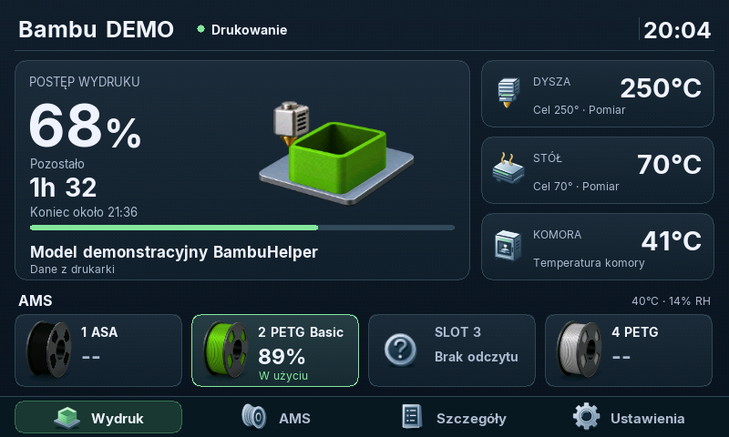
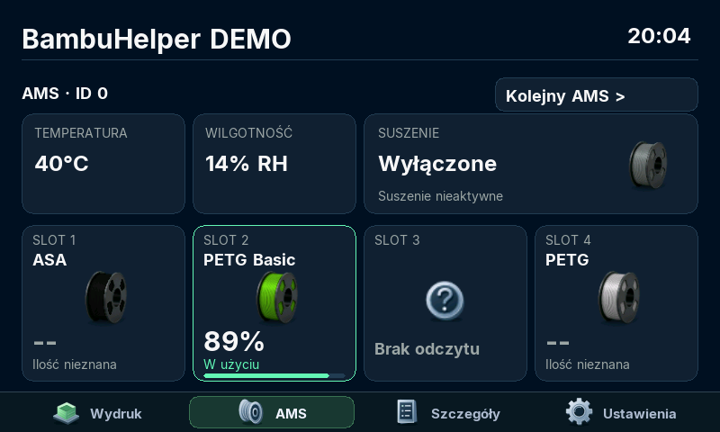
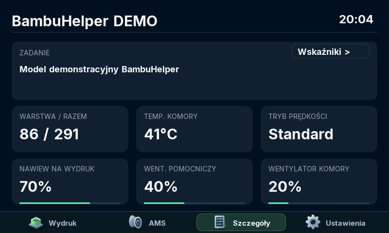
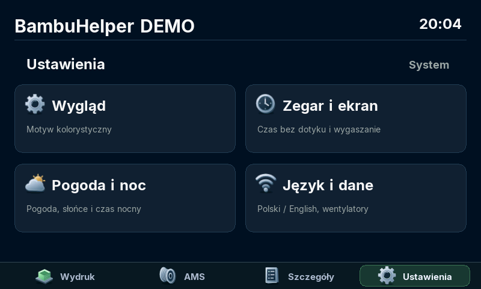
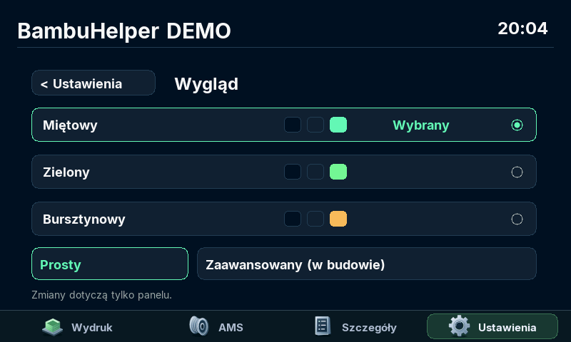
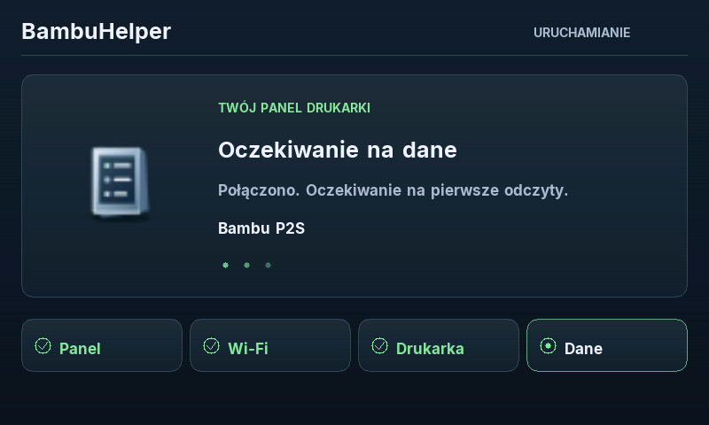

# BambuHelper — Waveshare 4.3B

[English](README.md) | **Polski** | [Deutsch](README.de.md)

Monitor drukarek Bambu Lab dla **Waveshare ESP32-S3-Touch-LCD-4.3B**, z dotykowym ekranem RGB **800×480**. Pokazuje dane drukarki i AMS, postęp wydruku, zegar i opcjonalną pogodę. Interfejs panelu oraz konfiguracja przez przeglądarkę są dostępne po polsku, angielsku i niemiecku.

To fork projektu [BambuHelper autorstwa Keralots i współtwórców](https://github.com/Keralots/BambuHelper). Gałąź `waveshare-43b` powstała na bazie oryginalnej wersji **v3.9.0** (`23347fbb`); `main` zachowuje historię projektu źródłowego.

> **Wersja rozwojowa:** zgłoszony [problem ciemnego ekranu i braku wybudzania dotykiem](https://github.com/honzo90/BambuHelper/issues/1) pozostaje otwarty. Przyczyna nie została ustalona, a pełna weryfikacja podczas całego cyklu drukowania jest nadal potrzebna. Poniższy opis przedstawia zaimplementowane funkcje, nie gwarancję stabilności sprzętu.

## Instalacja i aktualizacje

Obecny pakiet: **[v0.9 / Beta 3](https://github.com/honzo90/BambuHelper/releases/tag/v4.0.0-beta.3)**, wewnętrzny numer firmware **`v4.0.0-beta.3`**.

**Potwierdzenie z urządzenia — 24 października 2026:** właściciel projektu potwierdził działanie Bety 3 z niemieckim menu i WebUI na swoim panelu WS43B. To potwierdzenie tej wersji i interfejsu; nie zamyka zgłoszenia dotyczącego wygaszania i wybudzania.

### Pierwsza instalacja przez USB

Instalator USB udostępnia **Betę 2**. Po pierwszej konfiguracji przejdź do **Bety 3** przez OTA, aby korzystać z niemieckiego interfejsu.

1. Otwórz **[instalator BambuHelper](https://honzo90.github.io/BambuHelper/)** w Chrome lub Edge na komputerze. Instalacja przez USB nie działa na iPhonie.
2. Podłącz panel kablem USB obsługującym transmisję danych. Instalator jest przeznaczony wyłącznie dla **Waveshare ESP32-S3-Touch-LCD-4.3B**.
3. Potwierdź model płytki i usunięcie ustawień. Wybierz **Przygotuj instalację**, a następnie **Połącz i zainstaluj**.
4. Po wgraniu skonfiguruj Wi-Fi przez sieć panelu; dane połączenia pojawią się na ekranie. Późniejsze aktualizacje wykonuj przez WebUI panelu, w kanale **Beta**.

**Pierwsza instalacja kasuje pamięć flash, w tym ustawienia Wi-Fi, drukarki i poprzedni firmware.** Strona sprawdza obraz przed udostępnieniem instalacji. Samo wgranie przez przeglądarkę wymaga jeszcze testu na fizycznej płytce.

### Aktualizacja działającego panelu przez OTA

- **Beta 1 lub Beta 2 → Beta 3:** w WebUI wybierz kanał **Beta** i **Sprawdź aktualizacje**.
- **Alpha → Beta 3:** jednorazowo użyj ręcznej aktualizacji OTA i pliku `BambuHelper-ws_lcd_43b-v4.0.0-beta.3-ota.bin`.
- Pakiety, informacje o kompilacji i powiązane wersje źródeł: **[GitHub Releases](https://github.com/honzo90/BambuHelper/releases)**.

OTA wymaga istniejącego układu partycji WS43B z **dwoma slotami po 3 MiB**. Plik OTA zawiera samą aplikację i nie służy do pierwszej instalacji. Oryginalny instalator projektu Keralots nie obsługuje tego portu 4.3B.

## Funkcje forka

| Obszar | Co zawiera wersja WS43B |
|---|---|
| **Obsługa płytki** | Wyświetlacz RGB ST7262 800×480, dotyk pojemnościowy GT911 przez I2C oraz obsługa podświetlenia. |
| **Interfejs dotykowy** | Widoki pulpitu, AMS, szczegółów druku, wskaźników, zegara i ustawień z nawigacją dla panelu 4,3 cala. |
| **Telemetria drukarki** | MQTT/TLS przez LAN Direct lub Bambu Cloud; postęp, warstwy, pozostały czas, temperatury i odczyty wentylatorów, gdy drukarka je udostępnia. |
| **Telemetria AMS** | Materiał, kolor, pozostały filament, temperatura, wilgotność i stan suszenia w zakresie raportowanym przez drukarkę lub AMS. |
| **Aktualność danych** | Ocena poprawności i wieku poszczególnych odczytów, zachowywanie pól pominiętych w przyrostowych raportach MQTT oraz odróżnianie zera od braku danych. |
| **Tryby wyświetlania** | Tryb prosty i rozwijany tryb zaawansowany; widoki druku, suszenia i chłodzenia, zegar oraz wygaszacze, w tym Pong i zegar wodny. |
| **Polski / English / Deutsch** | Zapisywany wybór języka wspólny dla panelu i portalu konfiguracji. Niemiecki jest dostępny od `v4.0.0-beta.3`. |
| **Opcjonalna pogoda** | Dane Open-Meteo, wschód i zachód słońca oraz harmonogram nocny. Pogoda i wyszukiwanie lokalizacji wymagają Internetu. |
| **Konfiguracja i diagnostyka** | Ustawienia Wi-Fi, drukarki i ekranu, funkcje sterowania i OTA oraz `/monitor/status` i narzędzia przechwytywania obrazu na potrzeby rozwoju. |
| **Budowanie i testy** | Osobny proces Arduino CLI z ustaloną wersją SDK cache64, testy na komputerze, syntetyczne dane MQTT oraz generatory grafik i czcionek. |

MQTT, integracja z chmurą, portal WWW i obsługa pozostałych płytek pochodzą z oryginalnego projektu. Fork rozszerza je dla Waveshare 4.3B. Profil `BAMBU_MONITOR_ONLY=0` zawiera również kod sterowania oświetleniem komory i inteligentnym gniazdkiem. Zakres działania innych płytek, modeli drukarek i konfiguracji wielu drukarek nie został w całości zweryfikowany w tym forku.

## Przykładowe układy ekranów

To **podglądy 800×480 generowane na komputerze** przy użyciu funkcji wyświetlania, czcionek i grafik projektu oraz syntetycznych danych. Pokazują polski interfejs. Nagłówek demonstracyjny i sposób rysowania mogą różnić się od urządzenia. Podglądy nie są zdjęciami ani zrzutami z panelu i nie potwierdzają stabilności ekranu, dotyku ani wybudzania.

| Pulpit druku | AMS |
|---|---|
|  |  |

| Szczegóły druku | Ustawienia |
|---|---|
|  |  |

| Wygląd | Uruchamianie |
|---|---|
|  |  |

[Pochodzenie podglądów i sumy kontrolne źródeł](img/waveshare-43b/provenance.json).

## Budowanie i weryfikacja

Zacznij od **[instrukcji budowania i testów Waveshare](WAVESHARE.md)** — dokument jest po angielsku. Profil [`boards/ws_lcd_43b.ini`](boards/ws_lcd_43b.ini) korzysta z **Arduino ESP32 3.3.11** i SDK **cache64**, a kompilację prowadzi [`bringup/waveshare43b/integration/build.py`](bringup/waveshare43b/integration/build.py).

```sh
python3 -B bringup/waveshare43b/integration/build.py
```

To osobny proces Arduino CLI, nie środowisko PlatformIO. Powyższe polecenie buduje firmware; nie wgrywa go na urządzenie.

Bazowa opublikowana wersja źródeł przeszła kompilację ze świeżego klonu na macOS **18 października 2026 r.** Dokładny zakres i wyniki testów na komputerze zawiera [WAVESHARE.md](WAVESHARE.md#host-tests). Udana kompilacja i testy nie zamykają problemu ekranu ani nie zastępują sprawdzenia sprzętu.

## Mapa źródeł

- **Ekran i dotyk:** [integracja wyświetlacza](src/lgfx_panel_ws43b.cpp), [obsługa dotyku](src/button_touch_ws43b.cpp), [interfejs panelu](src/display_ws43b.cpp).
- **Telemetria i MQTT:** [stan danych](include/bambu_monitor.h), [parser raportów](include/bambu_monitor_parser.h), [połączenie MQTT](src/bambu_mqtt.cpp).
- **Zegar, pogoda, język:** [ustawienia zegara](src/ws43b_clock_settings.cpp), [pogoda](src/ws43b_weather.cpp), [wybór języka](src/ws43b_language.cpp).
- **Narzędzia:** [testy na komputerze](bringup/waveshare43b/integration/tests), [przygotowanie kompilacji](prepare_build.py), [informacje o komponentach zewnętrznych](THIRD_PARTY_NOTICES.md).

## Dokumentacja oryginalnego projektu

Poniższe odnośniki prowadzą do zachowanej **angielskiej dokumentacji upstream**. Obejmuje ona także inne płytki; jej instrukcji połączeń GPIO, PlatformIO i instalatora nie należy stosować bezpośrednio do WS43B. Dla 4.3B korzystaj z instrukcji powyżej i pliku `WAVESHARE.md`.

- [Obsługiwane płytki](README.md#supported-boards)
- [Łączenie z Bambu Cloud](README.md#connecting-to-bambu-cloud)
- [Bezpieczeństwo połączenia z chmurą](README.md#cloud-mode-security-notice)
- [Pomiar zużycia energii](README.md#power-monitoring)
- [Błędy drukarki i kody HMS](README.md#printer-errors-hms)
- [Własne czcionki](README.md#custom-smooth-fonts)

Polski dokument opisuje fork WS43B. Szczegółowa dokumentacja pozostałych płytek pozostaje w oryginalnej wersji językowej.

## Licencja i autorstwo

MIT. Projekt bazowy: [BambuHelper — Keralots i współtwórcy](https://github.com/Keralots/BambuHelper). Licencje komponentów zewnętrznych opisuje [THIRD_PARTY_NOTICES.md](THIRD_PARTY_NOTICES.md).
